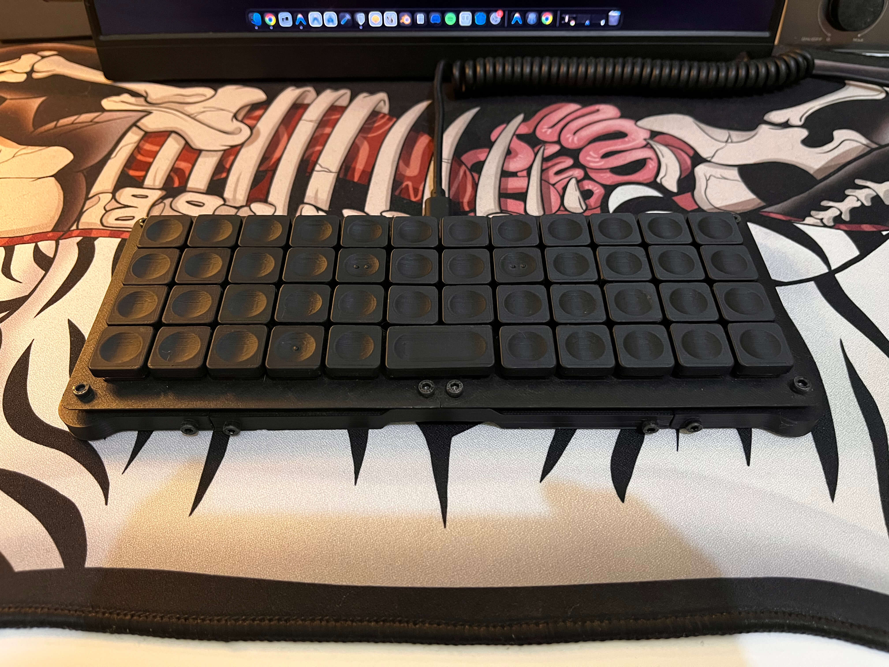

# diy_louder



A 4x12 (47-key) ortholinear mechanical keyboard powered by an RP2040 microcontroller running QMK firmware.

📁 **[3D Models](./model)** • 📷 **[View more photos in the Gallery](./gallery)**

---

## About the Project

**diy_louder** is my first handwired keyboard project, built in 2025 and inspired by the Work Louder XYZ board.

I personally designed and 3D modeled the case from scratch, which was also my first time learning CAD software. Because Work Louder hadn't released their case design publicly at the time, I modeled it entirely by studying reference images and photos from their website.

---

## Specifications

* **Keyboard Maintainer**: [irxd](https://github.com/irxd)
* **Form Factor**: 4x12 Ortholinear (47 keys)
* **Microcontroller**: Raspberry Pi RP2040
* **Bootloader**: RP2040 (`.uf2`)
* **Diode Direction**: `COL2ROW`
* **Features Enabled**: Bootmagic, Extrakey (Media controls), Mousekey, NKRO
* **License**: [GPL-2.0-or-later](./LICENSE)

### Pinout Configuration

* **Rows (4)**: `GP0`, `GP1`, `GP2`, `GP3`
* **Cols (12)**: `GP4`, `GP5`, `GP6`, `GP7`, `GP8`, `GP9`, `GP15`, `GP14`, `GP13`, `GP12`, `GP11`, `GP10`

---

## Bill of Materials (BOM)

| Component | Quantity | Price (IDR) | Price (USD) | Notes |
| :--- | :---: | :---: | :---: | :--- |
| **Kailh Choc v1 Brown** low-profile switches | 47 | Rp352.500 | $19.53 | Tactile low-profile switches |
| **Raspberry Pi Pico RP2040** | 1 | Rp42.500 | $2.35 | Microcontroller board |
| **M3x10 Hex Screws** | 20 | Rp11.000 | $0.61 | Case assembly & plate mounting |
| **Rubber Feet** (20×3×3 mm) | 4 | Rp8.000 | $0.44 | Non-slip base pads |
| **1N4148 Diodes** | 47 | Rp4.700 | $0.26 | Anti-ghosting switching diodes |
| **Copper Wire** (1.3 mm) | 1 | Rp11.400 | $0.63 | Matrix column/row wiring |
| **Jumper Wires** | 1 | Rp9.975 | $0.55 | Controller-to-matrix connections |
| **Total** | | **Rp440.075** | **~$24.37** | *(excluding 3D printing filament/case)* |

---

## 3D Models & Printing

All 3D files for the case are available in the [`model/`](./model) folder:

### Case Parts
* **CAD Source**: [`diy-louder.step`](./model/diy-louder.step) (full assembly STEP file for CAD inspection or customization)
* **Switch Plates**:
  * Left plate: [`plate-left.stl`](./model/plate-left.stl)
  * Right plate: [`plate-right.stl`](./model/plate-right.stl)
* **Frame & Structural Hardware**:
  * Corner: [`corner.stl`](./model/corner.stl)
  * Bridge: [`bridge.stl`](./model/bridge.stl)
  * Front Bridge: [`front-bridge.stl`](./model/front-bridge.stl)
  * Connector: [`connector.stl`](./model/connector.stl)
  * Spacer: [`spacer.stl`](./model/spacer.stl)

### Keycaps
The keycaps used in this project are the **Choc Louder Keycaps (Choc and MX spacing)**:
* 🔗 Download on Printables: [Choc Louder Keycaps (Choc and MX spacing)](https://www.printables.com/model/1066117-choc-louder-keycaps-choc-and-mx-spacing)

---

## Step-by-Step Setup Guide

### 1. Prerequisites

Make sure you have the QMK CLI installed and configured on your computer:

```bash
python3 -m pip install --user qmk
qmk setup
```

### 2. Add keyboard to QMK directory

Link or copy this `diy_louder` directory into your `qmk_firmware/keyboards/` directory:

```bash
# Option A: Symlink (recommended for development)
ln -s "$(pwd)" ~/qmk_firmware/keyboards/diy_louder

# Option B: Direct Copy
cp -r . ~/qmk_firmware/keyboards/diy_louder
```

### 3. Compile the Firmware

Compile the default keymap:

```bash
qmk compile -kb diy_louder -km default
```

*(Alternatively using make from inside `~/qmk_firmware`)*:

```bash
make diy_louder:default
```

This will produce a `.uf2` file (e.g. `diy_louder_default.uf2`).

### 4. Enter Bootloader Mode

To flash the board, place the RP2040 into bootloader mode using one of these methods:

* **Physical Button**: Hold down the `BOOT` / `BOOTSEL` button on your RP2040 board while plugging in the USB cable (or hold `BOOT` and press `RESET`).
* **Bootmagic Reset**: Hold down the top-left key (`Esc` at row 0, col 0) while plugging in the keyboard.

Once in bootloader mode, a removable drive named **`RPI-RP2`** will appear on your computer.

### 5. Flash the Firmware

Choose either method below:

* **Method A (Direct Drag & Drop - Recommended)**:
  Drag and drop the generated `diy_louder_default.uf2` file into the `RPI-RP2` drive. The drive will automatically unmount and the keyboard will reboot with your firmware.

* **Method B (QMK CLI)**:
  Run the flash command while the board is in bootloader mode:
  ```bash
  qmk flash -kb diy_louder -km default
  ```

---

## Keymap Layers

The keymap runs a 4x12 ortholinear layout with 3 layers configured in [`keymaps/default/keymap.c`](./keymaps/default/keymap.c). It is personally optimized for **macOS** and **coding workflows**, featuring quick access to programming brackets/symbols (`()`, `[]`, `{}`), macOS native shortcuts (such as screen captures `Cmd+Shift+3/4/5`), function keys, and navigation without lifting hands from the home row.

### Layer 0: Base (`_BASE`)

Standard QWERTY ortholinear layout with a centered 2u Spacebar, dedicated arrow cluster, and momentary layer switches (`RAISE` and `LOWER`).

| Row | 1 | 2 | 3 | 4 | 5 | 6 | 7 | 8 | 9 | 10 | 11 | 12 |
| :---: | :---: | :---: | :---: | :---: | :---: | :---: | :---: | :---: | :---: | :---: | :---: | :---: |
| **0** | `Esc` | `Q` | `W` | `E` | `R` | `T` | `Y` | `U` | `I` | `O` | `P` | `Backspace` |
| **1** | `Tab` | `A` | `S` | `D` | `F` | `G` | `H` | `J` | `K` | `L` | `;` | `'` |
| **2** | `Shift` | `Z` | `X` | `C` | `V` | `B` | `N` | `M` | `,` | `.` | `↑` | `Enter` |
| **3** | `Ctrl` | `Alt` | `F12` | `Cmd/GUI` | **RAISE** | `Space (2u)` | `Space (2u)` | **LOWER** | `/` | `←` | `↓` | `→` |

---

### Layer 1: Raise (`_RAISE`)

Activated by holding **RAISE**. Provides access to function keys (`F1`–`F11`), number row (`1`–`0`), and minus/equal.

| Row | 1 | 2 | 3 | 4 | 5 | 6 | 7 | 8 | 9 | 10 | 11 | 12 |
| :---: | :---: | :---: | :---: | :---: | :---: | :---: | :---: | :---: | :---: | :---: | :---: | :---: |
| **0** | `F1` | `F2` | `F3` | `F4` | `F5` | `F6` | `F7` | `F8` | `F9` | `F10` | `F11` | `Backspace` |
| **1** | `1` | `2` | `3` | `4` | `5` | `6` | `7` | `8` | `9` | `0` | `-` | `=` |
| **2** | `Shift` | `▽` | `▽` | `▽` | `▽` | `▽` | `▽` | `▽` | `▽` | `▽` | `▽` | `Enter` |
| **3** | `▽` | `▽` | `▽` | `▽` | `—` | `▽` | `▽` | `▽` | `▽` | `▽` | `▽` | `▽` |

---

### Layer 2: Lower (`_LOWER`)

Activated by holding **LOWER**. Provides symbols, brackets, macOS screenshot shortcuts (`Cmd+Shift+3/4/5`), volume control, and media playback keys.

| Row | 1 | 2 | 3 | 4 | 5 | 6 | 7 | 8 | 9 | 10 | 11 | 12 |
| :---: | :---: | :---: | :---: | :---: | :---: | :---: | :---: | :---: | :---: | :---: | :---: | :---: |
| **0** | `` ` `` | `\` | `▽` | `▽` | `▽` | `▽` | `▽` | `▽` | `▽` | `▽` | `▽` | `Backspace` |
| **1** | `▽` | `▽` | `Cmd+Shift+3` | `Cmd+Shift+4` | `Cmd+Shift+5` | `▽` | `(` | `)` | `[` | `]` | `{` | `}` |
| **2** | `▽` | `▽` | `▽` | `▽` | `▽` | `▽` | `▽` | `▽` | `▽` | `▽` | `Vol Up` | `Enter` |
| **3** | `▽` | `▽` | `▽` | `▽` | `▽` | `▽` | `▽` | `—` | `Play/Pause` | `Prev Track` | `Vol Down` | `Next Track` |

> [!NOTE]
> `▽` indicates a transparent key (`_______`) in QMK that passes through to the underlying Base layer.

---

## Gallery

Check out the build and hardware photos in the [gallery folder](./gallery):
* [IMG_3381.jpg](./gallery/IMG_3381.jpg)
* [IMG_3382.jpg](./gallery/IMG_3382.jpg)
* [IMG_3383.jpg](./gallery/IMG_3383.jpg)
* [IMG_3386.jpg](./gallery/IMG_3386.jpg)

---

## License

This project is licensed under the [GNU General Public License v2.0 or later (GPL-2.0-or-later)](./LICENSE).

